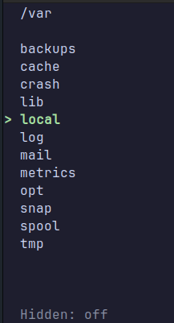
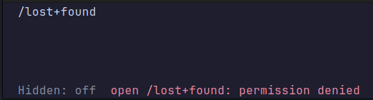

# Interactive CD command

Setup and simply run `ccd` in terminal.





## Keymap
Use keys `up` and `down` to choose directory.

Use `right` or `enter` to select chosen directory.

Use `left` or `esc` or `backspace` to go back.

Use `h` to toggle hidden directories.

Use `t` to switch between dark & light themes.

Use `s` to open or close the shortcuts list.

Use `a` to add the current directory as a shortcut.

Use `d` to remove the selected shortcut while the shortcuts list is open.

Use `q` to exit and cd into currently selected directory.

Use `ctrl+c` to exit without cd operation.

## Shortcuts

Save frequently used directories and jump to them without browsing.

Press `a` to add the current directory. Edit the suggested name and press `enter`
to save, or `esc` to cancel.

Press `s` to open the shortcuts list, then use `up`/`down` and `enter` to
navigate to a saved path. Press `d` to remove the selected shortcut.

Shortcuts are stored in `~/.config/ccd/shortcuts.json` (or
`$XDG_CONFIG_HOME/ccd/shortcuts.json`):

```json
{
  "shortcuts": [
    {
      "name": "project",
      "path": "/home/user/projects/example"
    }
  ]
}
```

## Shell Integration

Integration with various shells.

### Bash/Zsh
```bash
ccd() {
  local start="${1:-$PWD}" dir
  dir="$("/path/to/ccd/binary" "$start")" || return
  [ -n "$dir" ] && builtin cd -- "$dir"
}
```

## Todo

- [ ] Directory filter
- [ ] Help output
- [ ] Persistent memory between runs
- [x] Status bar (hidden status, error message)
